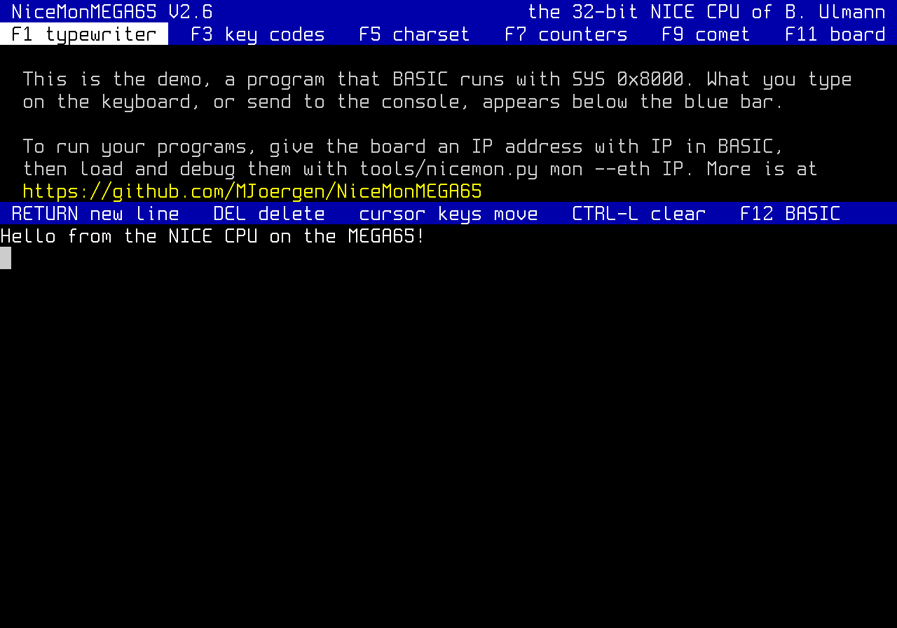
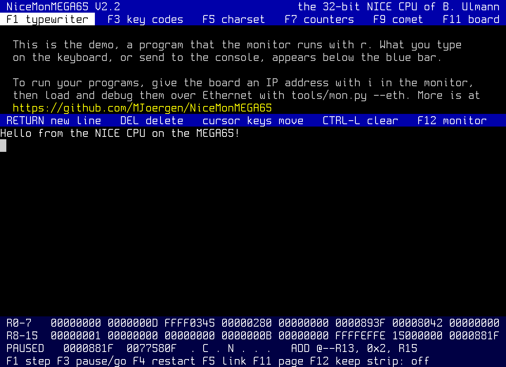
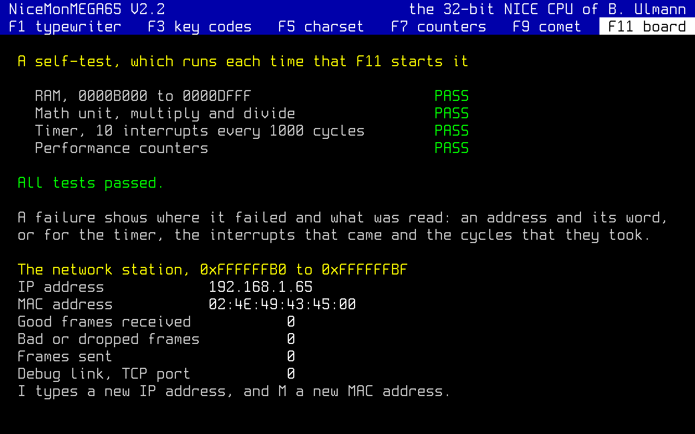

# NiceMonMEGA65

The NICE CPU on the MEGA65, with a monitor in its ROM, and remote control from a PC

The demo (see [demo/](demo/README.md)), a program that comes with each
release, drawn from the emulator by `tools/screenshot.py`.

This project runs the [NICE CPU](https://github.com/MJoergen/nice_cpu) on
the [MEGA65](https://mega65.org/) (R3 and R6), a modern FPGA computer in
the form of a Commodore 65. NICE is a 32-bit CPU with its own instruction
set, assembler, C toolchain, and emulator, `niceemu`. On the MEGA65, the
system shows a screen of 80×28 characters on HDMI and VGA, and reads the
keyboard. A program written in NICE assembly
([ISA.md](https://github.com/MJoergen/nice_cpu/blob/main/doc/ISA.md)),
or in C, runs on the board as it runs in `niceemu`. The system also
builds for the Digilent Nexys4DDR (see
[synth/](synth/README.md#the-nexys4ddr)).

A few words come up throughout:

- A **core** is the MEGA65's word for a design in its FPGA, which turns
  it into another computer. This project is one, and a core file
  (`.cor`) holds it. The other documents also call the NICE CPU itself
  "the core"; this one says "the processor".
- The **monitor** is the program in the ROM that the system starts
  with. It runs BASIC, whose `READY.` takes the statements that load
  and run programs ([basic/](basic/README.md)), and it has the
  routines that programs call ([monitor/](monitor/README.md)).
- **[Remote control](doc/DEBUG_LINK.md)** lets a PC load, run, pause,
  step, and inspect programs on the board, over its Ethernet port or its
  serial port. It is nice_cpu's
  [debug link](https://github.com/MJoergen/nice_cpu/blob/main/doc/DEBUG.md).
- The **console** is a program's text input and output. The output goes
  to the PC, over the same connection as remote control, and the input
  comes from the PC and from the keyboard.
- A **`.bin` file** is a program ready to load. It is text: one line
  per word, with its address and its value in hex.

There are three ways to use the system:

- [On its own](#on-its-own), as a MEGA65 with a keyboard and a screen,
  and no cable to a PC. The MEGA65 starts the core from its flash, and
  the monitor loads programs from the SD card. MEGA+HELP brings up a
  [debugger](#the-on-board-debugger) on the screen.
- [Over Ethernet](#over-ethernet), where a PC on the network loads
  programs by remote control, talks to them, and debugs them.
- [Over the serial port](#over-the-serial-port), where a PC does the
  same, with the same tools. This needs a JTAG cable.

## Quick start

1. Download the core file for your board from the latest
   [release](https://github.com/MJoergen/NiceMonMEGA65/releases):
   `nicemon-TAG-r6.cor` for the R6, or `nicemon-TAG-r3.cor` for the R3
   and R3A, where TAG is the release, such as `V2.5`. A core file holds
   its board revision, so use the one for yours.
2. Copy it to the SD card, and hold No Scroll while you switch the MEGA65
   on. MEGAFLASH, the MEGA65's core menu, appears. Let it write the core
   file into a free slot of the flash.
3. Start the system from that slot. The screen shows the monitor's
   banner and BASIC's `READY.`. Type `HELP` and RETURN for the
   statements.
4. For the demo, download `demo.bin` from the same release, and copy it
   into the folder `NICE` of an SD card (see [The SD cards](#the-sd-cards)).
   Put the card in the board, and type `LOAD "DEMO.BIN"` and RETURN,
   then `SYS 0x8000` and RETURN.

## On its own

With nothing connected but a screen, the MEGA65 starts the
[monitor](monitor/README.md) from the ROM. It shows its version and
`READY.`, and takes a statement of its BASIC on each line. BASIC has
numbers and strings, arrays, and programs with loops, functions, and
procedures, which a card keeps, and a screen editor
([basic/README.md](basic/README.md)). A program cannot catch its
errors yet, and has no statements for the colors and the cursor
([doc/BASIC.md](doc/BASIC.md#stages)).

| Statement | What it does |
|---|---|
| `HELP` | Lists the statements |
| `DIR` | Lists the files on the SD card |
| `LOAD "NAME.BIN"` | Loads a program from the SD card |
| `SYS 0x8000` | Runs the program that was loaded |
| `RUN "NAME.BIN"` | Loads a program from the SD card and runs it |
| `BSAVE "NAME", A, N` | Saves N words of memory, from A on, to the SD card |
| `SAVE "NAME"`, `LOAD "NAME"` | Saves BASIC's program to the SD card as the text `NAME.BAS`, and loads it |
| `LOAD` | Loads a program that you type or paste, as the lines of its `.bin` file |

Keywords are in either case, and numbers in decimal, or in hex after
`0x`. [basic/README.md](basic/README.md#the-statements) has the others, such
as `DUMP`, which shows memory, and `DIS`, which disassembles it.

The monitor loads a program at address `0x8000`, above the ROM. The
program has 90K words of RAM on the MEGA65, `0x8000` to `0x1E7FF`, and
26K on the Nexys4DDR. For `LOAD`, paste the `.bin` file into a plain TCP
client on the Ethernet port, or a terminal on the serial port
([basic/README.md](basic/README.md#loading-without-a-host)).

Each release comes with a [demo](demo/README.md), `demo.bin`, a
program for the monitor: `LOAD "DEMO.BIN"` and `SYS 0x8000` run it
from the card.
It shows the version and how to go further, and below that it is a
typewriter: what you type appears on the screen.
RETURN starts a new line, INST/DEL deletes, the cursor keys move the
cursor, and CTRL-L clears what you typed. The function keys switch
between the demos that the second row lists, and F12 (SHIFT and F11)
goes back to BASIC. The reset button starts the monitor again at
any time.

Each release also has `weather.bin`, a weather display for the monitor:
the weather of a place from the Internet, with the date and the time,
fetched again every 10 minutes. It needs the Ethernet port on a network
with a DHCP server. [examples/README.md](examples/README.md#the-weather-display)
says how to choose the place.

The ROM can also hold a program of your own (see
[Building your own ROM](#building-your-own-rom)).

### The SD cards

The monitor reads and writes files on FAT32 cards, in the folder `NICE`
of the root directory, with `DIR`, `LOAD`, `SAVE`, and `DELETE`. To run a
program from a card:

1. On a PC, make the folder `NICE` on the card, and copy the program's
   `.bin` file into it. The monitor never makes the folder, and fails
   on a card without it, as a card may be shared with other cores, each
   with a folder of its own. With no PC slot, `make sdcard CMD=mkdir`
   makes it over the link, on a card that has FAT32, and
   `make sdcard CMD="--slot 0 format"` formats a card as FAT32 with
   the folder, erasing all of it.
2. Put the card in the board, and type `LOAD "NAME.BIN"` and then
   `SYS 0x8000`.

On the MEGA65, slot 0 is the microSD slot at the back, and slot 1 the
full-size slot underneath. The monitor takes the card in slot 0, or
the one in slot 1 when slot 0 is empty. The card in slot 1 holds the
MEGA65's system files: a program that writes there can damage them, so
test one on a card of its own in slot 0. On the Nexys4DDR, slot 0 is
its microSD slot.

A PC reaches the card by remote control too, with no card reader:
`make sdcard ETH=192.168.1.65 CMD=ls` lists `NICE`, `CMD="get NAME"`
copies a file off the card, `CMD="put FILE"` writes one,
`CMD="del NAME"` deletes one, `CMD=mkdir` makes the folder `NICE`, and
`CMD="--slot N format"` erases the card and writes a new FAT32.
After a write, the monitor starts again from reset
([tools/README.md](tools/README.md#nicemonpy-sd)). On Linux,
`make sdnbd ETH=192.168.1.65` serves the whole card as a disk, which
`nbd-client` connects and the PC mounts as a folder, for the file
manager, while the core is held
([tools/README.md](tools/README.md#nicemonpy-nbd)).

### A new BASIC

BASIC is the upper part of the ROM, and on the MEGA65 a card can bring
a newer one, with no new core file. The Nexys4DDR's ROM takes no
writes, so it always runs its bitstream's BASIC. A BASIC file fits
only the cores of its own layout of the ROM and the screen: the files
before V2.4 fit the cores before V2.4, those of V2.4 and V2.4.1 fit
the cores of V2.4 and V2.4.1, and those from V2.5 on fit the cores
from V2.5 on. The monitor passes over a file that does not fit, and runs
the BASIC of its core. Each release has its BASIC as a file of its
own, such as `BASIC-V2.5.ROM`. To use it:

1. Copy the file into the folder `NICE` of a card. Older ones may stay
   there, as the monitor takes the highest version.
2. Switch the board off and on. The monitor loads the file and names
   it, `BASIC-V2.5.ROM from card 0`, before the banner, which shows
   both versions: `NiceMon V2.5, BASIC V2.5`.

The monitor checks the file first. One that fails, such as a file cut
short, gets a line that says why, and the next highest version is
tried; with none, the core's own BASIC runs. A BASIC older than the
core's runs too, with a note. The monitor loads only after the board
is switched on: the reset button and `SYS 0` keep the BASIC that runs.

If a BASIC from a card hangs at its start, take the card out and
switch the board off and on, so that the core's own BASIC runs. Then put
the card back, and remove the file with `DELETE "BASIC-V2.5.ROM"`.

Over the network, `tools/nicemon.py load --eth 192.168.1.65 --basic
BASIC-V2.5.ROM` puts a BASIC into the ROM at once, until the board is
switched off ([tools/README.md](tools/README.md#loading-basic-into-the-rom)).

A program reads and writes files through the monitor's routines
([monitor/README.md](monitor/README.md#files)), or drives the SD card
controller itself, a sector of 512 bytes at a time.
[SYSTEM.md](doc/SYSTEM.md#the-sd-card-slots) has the details, and the
limits of the R3.

### The on-board debugger

MEGA+HELP brings up the debugger, with no cable and no PC. On the
Nexys4DDR the key is Scroll Lock. The debugger shows a strip of four
rows under the program's screen, and the keyboard is the debugger's
until MEGA+HELP is pressed again. The program keeps running until F3
pauses it.

The demo, paused by F3 after a line was typed, drawn from the emulator
by `tools/screenshot.py --debugger`, which lays the strip out as the
board does.

The strip shows:

- The registers R0 to R15, live while the program runs.
- The state of the program, the PC, the instruction word there, and the
  flags of the status register.
- The instruction at the PC, decoded in the assembler's syntax.
- The keys.

| State | What it means |
|---|---|
| `RUNNING` | The program runs |
| `WAITING` | The program waits for an interrupt |
| `PAUSED` | The program is paused; `PAUSED W` when it was waiting |
| `BRK n` | The program stopped at breakpoint n |
| `WCH n` | The program stopped at watchpoint n, which only a PC sets |
| `HALTED n` | The program halted: n is 1 after `HALT`, and 2 to 4 after an error |
| `HELD` | The processor is held in reset |

| Key | Action |
|---|---|
| F1 | Step: one instruction of a paused program |
| F3 | Pause, or go on |
| F4 (SHIFT and F3) | Restart the program from address 0 |
| F5 | The settings page, on or off |
| F11 | The page of memory, on or off |
| F12 (SHIFT and F11) | Keep the strip up after MEGA+HELP, or not |
| MEGA+HELP | Back to the program, which gets its keyboard again |

**The page of memory** (F11) replaces the program's screen with a
window on the memory. The cursor keys move through it, CTRL and MEGA
with CRSR up or down a page at a time, and CLR/HOME to the window's
first word. Hex digits and RETURN write a word at the cursor, `a` and
an address move the window there, `b` sets a breakpoint at the cursor
or clears it, and ESC leaves. The program stops at a breakpoint, and
the strip says `BRK n`.

**The settings page** (F5) shows the IP address, the MAC address, the
TCP port, and the serial port's baud rate, as `192.168.1.65`,
`02:4E:49:43:45:06`, `4510`, and `230400`. CRSR up and down choose a
setting, and you type the new value as it is shown, or step through the
baud rates with CRSR left and right; RETURN writes it. The program must
be paused, halted, or held. A new address breaks a PC's TCP connection,
and a new rate cuts off a PC on the serial port until it follows with
`--baud`; a reset brings back 230400.

**Keeping the strip** (F12): with `keep strip: on`, the strip stays on
the screen when MEGA+HELP goes back to the program. It shows the
registers live while the keys are the program's, and a halt or a
breakpoint brings the debugger back.

The debugger cannot load a program. That takes the monitor, or a PC
over [Ethernet](#over-ethernet) or the
[serial port](#over-the-serial-port), which keeps its connection while
the debugger is up. [DEBUGGER.md](doc/DEBUGGER.md) has the design.

## Over Ethernet

Remote control runs over the board's Ethernet port, on TCP port 4510. A
PC on the network may then load, run, and debug programs, with no JTAG
cable. Remote control has no password, and the monitor gets an IP
address from the network on its own
([Giving the board an address](#giving-the-board-an-address)), so plug
the cable only into a network you trust.

### Setting up the tools

The monitor needs no tools on a PC. They are for building programs, and
for remote control, over Ethernet as here or over the
[serial port](#over-the-serial-port). They are all in this repository.
Clone it with the submodule, which has the assembler, the emulator, and
the C library:

    git clone --recurse-submodules https://github.com/MJoergen/NiceMonMEGA65.git

or, in an existing clone:

    git submodule update --init

The tools need only Python 3, on Linux or macOS. The emulator, `niceemu`,
is built with `make -C nice_cpu/emulator build`, which needs Zig (see
[nice_cpu/emulator/](https://github.com/MJoergen/nice_cpu/blob/main/emulator/README.md)).

### Giving the board an address

After a reset the board has no IP address. The monitor asks the
network's DHCP server for one on its own, in the background, while it
waits for a line. When the server answers, a few seconds after the
reset, the monitor shows the address after `READY.`:

    READY.
    IP address 192.168.1.253 from DHCP

Without a cable or a server, nothing is shown, and the monitor asks
again, less and less often. BASIC's statements also set an address:

| Statement | What it does |
|---|---|
| `IP "192.168.1.65"` | Sets the IP address; `IP` alone shows it |
| `DHCP` | Gets an address from the network's DHCP server, and shows it with the mask, the gateway, the DNS server, the DHCP server, and the time server, if the network has one |
| `MAC "02:4E:49:43:45:01"` | Sets the MAC address; `MAC` alone shows it. A second board on the same network needs one of its own |

The board renews a DHCP lease while BASIC waits for a line,
and while a program uses the network. A program that does not use the
network renews nothing, so if it runs longer than the lease, the server
may give the address to another computer. A fixed address outside the
server's range, or one that the server reserves for the MAC address,
avoids that.

The on-board debugger's settings page (F5) sets the addresses too, and
so does the demo's F11, where I types a new IP address, and M a new MAC
address:

### Loading a program from the network

Once the board has an address, `LOAD "HELLO.BIN", "192.168.1.10"`
loads a program from a TFTP server on the network, as `LOAD` loads one
from the card. `make tftpd` on a PC is such a server: it serves
`examples/build`, and `DIR "192.168.1.10", "*.BIN"` lists its programs
([monitor/README.md](monitor/README.md#the-network), which also says
how to serve without root). `make tftpd ARGS=--write` also takes
files from the board: `SAVE "CHESS", "192.168.1.10"` writes the
program to the PC, and `BSAVE "DATA", 0x9000, 100, "192.168.1.10"`
writes words. TFTP has no login, so anyone who reaches the port may
write to the folder while `--write` is on.

### Setting the clock from the network

Once the board has an address, `NTP "", "+01:00"` sets
its clock from a time server on the internet, `pool.ntp.org`, or from
the network's own when DHCP names one. A time server gives UTC, the
time of no time zone, and the clock keeps local time. So the statement
takes the difference, local time less UTC: `+01:00` in Central Europe
in winter, and `+02:00` in summer. Without it, the clock is set to
UTC. A server's name or address comes first, in place of `""`, as in
`NTP "192.168.1.1", "+01:00"`.

On the MEGA65 the statement sets the real-time clock too, so the time
stays over a power cycle. The Nexys4DDR has no real-time clock, so
there `NTP` after each reset is the way to set the clock without a
PC ([basic/README.md](basic/README.md#the-statements)).

### Talking to a program

There are two ways to talk to a program on the board from a PC:

- `tools/nicemon.py mon --eth 192.168.1.65` is an interactive shell (see
  [Using the interactive shell](#using-the-interactive-shell)). At its
  prompt, it takes debug commands and shows the program's output, and
  `send TEXT` sends text to the program. Its `console` command passes
  your keys straight to the program, as a terminal does, until Ctrl-]
  returns to the prompt. There the Enter key is the board's RETURN,
  which runs the monitor's line.
- A plain client, such as `nc 192.168.1.65 4510`, is a terminal to the
  program. It sends each line you type to the program, and shows what
  it prints. It has no remote control: it cannot load a program, pause
  it, or read its memory, and a message of the link shows in it as raw
  text, such as `h01#C9` when the program halts.

The other tools take `--eth 192.168.1.65` too
([tools/README.md](tools/README.md#over-ethernet)).
`tools/nicemon.py load --eth 192.168.1.65 prog.bin` loads a program and starts
it, and [SYSTEM.md](doc/SYSTEM.md#the-ethernet-station) describes the
Ethernet station.

### One connection at a time

The board serves one PC at a time. While a PC is connected, it has the
program's console and remote control to itself: what comes in on the
[serial port](#over-the-serial-port) is dropped, and all output goes to
the PC. When the PC disconnects, they go back to the serial port. The
[on-board debugger](#the-on-board-debugger) works beside the PC, which
keeps its connection while the debugger is up.

Ctrl-C ends `nc`. The program then reads the end of its input from the
PC, though the keyboard still types, until the program is started again
or a PC connects again. The board also keeps the closed connection, so
the serial port stays cut off until a tool connects from the same PC,
such as `tools/nicemon.py mon --eth 192.168.1.65`, or the board is reset. The
tools end their connections so that the serial port is back at once.

## Over the serial port

Remote control runs over the MEGA65's serial port too, its debug UART.
It needs the JTAG cable, whose USB port carries it.
`tools/nicemon.py mon --port /dev/ttyUSB1` is then the interactive shell, and a
terminal program, such as `picocom`, the plain client, as
[over Ethernet](#over-ethernet). The other tools take `--port` too. To
set them up, see [Setting up the tools](#setting-up-the-tools).

The port runs at 230400 baud, 8-N-1, after reset, which is the tools'
default on Linux and macOS alike. BASIC's `BAUD` sets another
rate, from 115200 to 2 Mbaud, which the tools then take with `--baud`
([DEBUG_LINK.md](doc/DEBUG_LINK.md#the-baud-rate)). On Linux, 2 Mbaud
loads a program about nine times as fast.

The serial port also gives the board its IP address without the
keyboard. Pause the monitor, write the address to `0xFFFFFFB0`, the
first byte in bits 31..24, here 192.168.1.65, and go on:

    tools/nicemon.py mon --port /dev/ttyUSB1
    dbg> pause
    dbg> w FFFFFFB0 C0A80141
    dbg> go
    dbg> q

## Using the interactive shell

`tools/nicemon.py mon` takes the connection to the board as an option, as the
other tools do: `--eth` for the Ethernet port, or `--port` for the
serial port. One of the two must be given:

    tools/nicemon.py mon --eth 192.168.1.65
    tools/nicemon.py mon --port /dev/ttyUSB1

The shell is the same either way. It starts by printing the state of
the processor:

<pre>
$ <b>tools/nicemon.py mon --eth 192.168.1.65</b>
halted: HALT, ROM hidden, control 0000000a, link version 0.8, input free 2048
PC=0000000f
interrupts: none
</pre>

The processor may be running, paused, at a breakpoint, held in reset,
halted, or held after a halt, with the reason. Then come whether the
ROM is hidden, the value of the control register, the version of the
link as major.minor, and the free bytes in the program's input buffer.
A paused or halted processor shows its PC too, and whether an interrupt
is pending or being served. The ROM is hidden when a tool has loaded a
program at address 0 in its place, to run it as the emulator does; the
reset button brings the monitor back.

Numbers are hex. These are the commands used most:

| Command | What it does |
|---|---|
| `help`, `help CMD` | Lists the commands, one on a line with what it does, or describes one in full |
| `status` | Prints the state again |
| `load FILE` | Loads a program at address 0, and leaves the processor held in reset |
| `go` (`g`), `pause`, `step N` (`s`) | Starts the program or goes on, pauses it, or runs N instructions of it |
| `b ADDR`, `bd N` | Sets a breakpoint, or disables it |
| `regs`, `r ADDR N` | Shows the registers, or N words of memory |
| `w ADDR WORD` | Writes a word of memory |
| `set Rn VALUE`, `pc ADDR` | Sets a register, or the PC, of a paused processor |
| `d ADDR N` | Disassembles N instructions |
| `send TEXT`, `console` (`c`) | Sends text to the program, or passes your keys to it until Ctrl-] |
| `quit` (`q`) | Leaves the shell, and the processor as it is |

The program's output and the link's messages, such as
`[paused, PC=...]`, are shown as they arrive. The shell is nice_cpu's
debugger, with the prompt `dbg>`, and its
[debugger/README.md](https://github.com/MJoergen/nice_cpu/blob/main/debugger/README.md#the-commands)
describes every command; [tools/README.md](tools/README.md#nicemonpy-mon) has
what the board adds.

### A worked example

This session ran on the MEGA65 R6, over its Ethernet port at
192.168.1.65, with `sim/echo.nasm`. The program echoes what it reads
from the console, and halts at a `.`. These are its instructions, and
their addresses:

    0  LOOP  MOVE    R1, @CONSOLE      ; bit 8 set when a byte has arrived
    2        AND[M]  R2, R1, 0x100
    4    ?Z  JMP     LOOP              ; nothing yet
    6        AND     R1, R1, 0xFF
    8        MOVE    @CONSOLE, R1      ; echo the byte
    A        SUB[M]  R2, R1, 0x2E      ; a '.'?
    C   ?!Z  JMP     LOOP
    E        HALT

Assemble it, and start `nicemon.py mon`. The state shown here is that after an
earlier program halted. Load the program, and the processor is held in
reset, with the program in memory. The control register then reads
`00000009`: bit 0 holds the processor, and bit 3 hides the ROM
([DEBUG_LINK.md](doc/DEBUG_LINK.md#the-control-register)):

<pre>
$ <b>python3 nice_cpu/assembler/niceasm.py -o echo.bin sim/echo.nasm</b>
$ <b>tools/nicemon.py mon --eth 192.168.1.65</b>
halted: HALT, ROM hidden, control 0000000a, link version 0.8, input free 2048
PC=0000000f
interrupts: none
'help' lists the commands, and 'q' quits.
dbg&gt; <b>load echo.bin</b>
loaded 15 words; the processor is held in reset
dbg&gt; <b>status</b>
held, ROM hidden, control 00000009, link version 0.8, input free 2048
dbg&gt; <b>r 0 f</b>
00000000: 00007800 ffffff00 03a080b0 00000100 3003d800 00000000 01a040b0 000000ff
00000008: 001c0080 ffffff00 022080b0 0000002e b003d800 00000000 0c000000
</pre>

Start the program, and pause it. It waits in its loop for input. The PC
comes with the instruction there, the next one to run. R14 is the
status register, and it reads `0x09000000`: Z (bit 27), as no byte has
arrived, and bit 24, which is always 1. A jump is a move to R15, the
PC, so the shell shows `?Z JMP LOOP` as `?Z MOVE R15, 0x0`:

<pre>
dbg&gt; <b>go</b>
dbg&gt; <b>pause</b>
[paused, PC=00000000  MOVE R1, @0xffffff00]
dbg&gt; <b>regs</b>
R0  00000000 R1  00000000 R2  00000000 R3  00000000
R4  00000000 R5  00000000 R6  00000000 R7  00000000
R8  00000000 R9  00000000 R10 00000000 R11 00000000
R12 00000000 R13 00000000 R14 09000000 R15 00000000
dbg&gt; <b>s 3</b>
PC=00000002  AND[M] R2, R1, 0x100
PC=00000004  ?Z MOVE R15, 0x0
PC=00000000  MOVE R1, @0xffffff00
</pre>

Set a breakpoint at 6, which the program reaches only when a byte has
arrived, and go on. Send it an `A`, and it stops. R1 holds the console's
read: bit 8 set, and `0x41`, the `A`. R14 is `0x01000000`, as Z is clear:

<pre>
dbg&gt; <b>b 6</b>
0: 00000006
dbg&gt; <b>g</b>
dbg&gt; <b>send A</b>
[breakpoint 0, PC=00000006  AND R1, R1, 0xff]
dbg&gt; <b>regs</b>
R0  00000000 R1  00000141 R2  00000100 R3  00000000
R4  00000000 R5  00000000 R6  00000000 R7  00000000
R8  00000000 R9  00000000 R10 00000000 R11 00000000
R12 00000000 R13 00000000 R14 01000000 R15 00000006
dbg&gt; <b>s</b>
PC=00000008  MOVE @0xffffff00, R1
dbg&gt;
A
PC=0000000a  SUB[M] R2, R1, 0x2e
dbg&gt;
PC=0000000c  ?!Z MOVE R15, 0x0
</pre>

An empty line repeats the last `step` command, here one step at a time.
The step at 8 echoes the `A`. Then disable the breakpoint, go on, and
type to the program in the console, until Ctrl-]. A `.` ends it:

<pre>
dbg&gt; <b>bd all</b>
dbg&gt; <b>g</b>
dbg&gt; <b>c</b>
console; Ctrl-] returns to the prompt
Hello
dbg&gt; <b>send .</b>
.
[halted: HALT, PC=0000000f]
dbg&gt; <b>status</b>
halted: HALT, ROM hidden, control 0000000a, link version 0.8, input free 2048
PC=0000000f
interrupts: none
dbg&gt; <b>q</b>
</pre>

## Writing programs

Programs are NICE assembly, or C through WebAssembly, built on a PC
into `.bin` files, with the tools of this repository (see
[Setting up the tools](#setting-up-the-tools)). There are two kinds:

| | A program on its own | A program under the monitor |
|---|---|---|
| Built at address | 0 | `0x8000` |
| Loaded by | `tools/nicemon.py load`, which hides the ROM | BASIC's `LOAD`, from the card, a paste, or TFTP, or `tools/nicemon.py load --monitor` |
| It may use | The hardware's registers | Those, and the monitor's routines for the screen, the files, and the network |
| `printf` prints | To the PC | To the screen and the PC |
| In `niceemu` | It runs the same | It runs behind the monitor, joined into one file |

[PROGRAMMING.md](doc/PROGRAMMING.md) has how to write, build, and run
both, the C library, and the memory limits, and
[tools/README.md](tools/README.md#running-a-program-under-the-monitor)
has `nicemon.py load --monitor`.

### Building your own ROM

The ROM can hold a program of your own, built into a core file of your
own. There are two steps: first the program, then the core.

The program is
[NICE assembly](https://github.com/MJoergen/nice_cpu/blob/main/doc/ISA.md),
assembled with `niceasm` into a `.bin` file, like any other program:

    python3 nice_cpu/assembler/niceasm.py -o prog.bin prog.nasm

[PROGRAMMING.md](doc/PROGRAMMING.md#programs-in-the-rom) has the limits
of a program in the ROM. Try the program in `niceemu` first, as there
is currently no way to put a new ROM into the MEGA65 without building a
new core file.

Then build the core file with the program as its ROM:

    make cor ROM=prog.bin

That builds the cores of the R3 and the R6, with `prog.bin` in their
ROM in place of the monitor. It needs Vivado and `coretool` (see
[synth/](synth/README.md)). The core files are
`synth/r6/build/NiceMonMEGA65-r6.cor` and
`synth/r3/build/NiceMonMEGA65-r3.cor`.

After that build, a change of the program needs no build from nothing:

    make cor ROMPATCH=prog.bin

puts the new `prog.bin` into the cores of the last build, in about a
minute each ([synth/](synth/README.md#a-change-of-the-rom-alone)).

## On the Nexys4DDR

A Nexys4DDR starts the system from its flash, as the MEGA65 does. Write
the release's `nicemon-TAG-nexys4ddr.bit` into the flash once, over the
board's USB cable, with
`make flash PORT=/dev/ttyUSB1 BIT=nicemon-TAG-nexys4ddr.bit`
(needs openFPGALoader). Set jumper JP1 (MODE) to QSPI. The board then
shows the monitor when it is switched on, with a USB keyboard in its
USB HID port (see [synth/](synth/README.md#building)).

## Documentation

- [doc/](doc/README.md) has the reference documents: how to write
  programs, the address map, remote control, and the differences from
  the emulator.
- [basic/README.md](basic/README.md) describes BASIC: its statements,
  its numbers, its strings, and its programs.
- [monitor/README.md](monitor/README.md) describes the monitor: its
  routines for programs, the files, and the network.
- [tools/README.md](tools/README.md) describes the tools on the PC.
- [RELEASE_NOTES.md](doc/RELEASE_NOTES.md) has what changed in each
  release.
- [CONTRIBUTING.md](CONTRIBUTING.md) is for those who change this
  repository: the tests, the formal checks, and the board test.

## License

MIT, see [LICENSE](LICENSE), like the files copied from cmod-s7 and
MandelbrotMEGA65. The exceptions are the third-party files named in
[synth/README.md](synth/README.md):

- `synth/r3/max10.vhd` is GPL v3. It has no license header of its own, so
  this rests on its origin in the MEGA65 core.
- The HDMI output in `synth/mega65/hdmi/` is LGPL v3.
- The Spleen font in `src/video/font_pkg.vhd` is BSD 2-Clause, see
  `font/LICENSE.spleen`.

`src/kbd_m65.vhd` is written after the GPL v3 driver of MiSTer2MEGA65,
with the same timing on the pins but none of its code, and is MIT like the
rest of `src/`.
