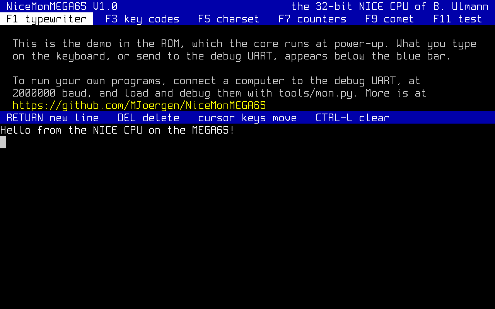
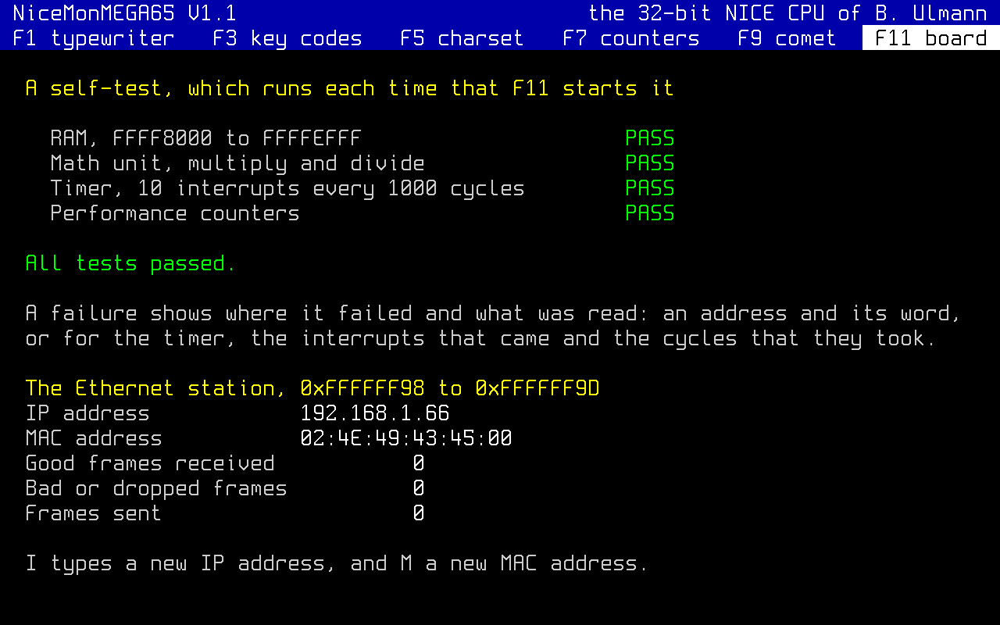

# NiceMonMEGA65

The NICE CPU on the MEGA65, with a debug link and a demo in its ROM

The demo in the ROM, which the core runs at power-up (see
[demo/](demo/README.md)), drawn from `niceemu` by `tools/screenshot.py`.

This project runs the [NICE CPU](https://github.com/MJoergen/nice_cpu) on
the [MEGA65](https://mega65.org/) (R3 and R6), a modern FPGA computer in
the form of a Commodore 65. NICE is a 32-bit CPU with its own instruction
set, assembler, C toolchain, and emulator, `niceemu`. On the MEGA65, the
system shows a screen of 80×25 characters on HDMI and VGA, and reads the
keyboard. A program written in NICE assembly
([ISA.md](https://github.com/MJoergen/nice_cpu/blob/main/doc/ISA.md))
runs on the board as it runs in `niceemu`. The system also builds for
the Digilent Nexys4DDR (see [synth/](synth/README.md#the-nexys4ddr) and
[SYSTEM.md](doc/SYSTEM.md#the-nexys4ddrs-devices)).

The Ethernet port, or the debug UART, carries the program's console and
the debug link, which a PC may use to load, run, pause, step, and
inspect programs.

There are three ways to use the system:

- [On its own](#on-its-own), as a MEGA65 with a keyboard and a screen,
  with no JTAG cable and no serial cable. The program is in the core's
  ROM, and the core is loaded from the MEGA65's flash.
- [Over Ethernet](#over-ethernet), with no JTAG cable, where a PC on
  the network may load programs over the debug link, talk to them, and
  debug them.
- [Over the serial port](#over-the-serial-port), with a JTAG cable,
  where a PC does the same, with the same tools.

A monitor like QMON, the one in
[QNICE-FPGA](https://github.com/sy2002/QNICE-FPGA), is planned but not
written yet (see [monitor/](monitor/README.md)). It will be in the ROM,
and will let a MEGA65 on its own load, run, and debug programs too.

## Quick start

1. Download the core file for your board from the latest
   [release](https://github.com/MJoergen/NiceMonMEGA65/releases):
   `nicemon-TAG-r6.cor` for the R6, or `nicemon-TAG-r3.cor` for the R3
   and R3A, where TAG is the release, such as `V1.1`. A core file holds
   its board revision, so use the one for yours.
2. Copy it to the SD card, and hold No Scroll while you switch the MEGA65
   on. MEGAFLASH, the MEGA65's core menu, then writes the core file into
   a slot of the flash.
3. The board then starts the system from that slot. The screen shows a
   welcome, and what you type appears on it (see
   [On its own](#on-its-own)).

No JTAG cable is needed. With one, `make flash
COR=nicemon-V1.0-r6.cor SLOT=1` writes the core file into slot 1 without
the SD card and No Scroll (see [synth/](synth/README.md#building)).

A Nexys4DDR starts the system from its flash in the same way. Write the
release's `nicemon-TAG-nexys4ddr.bit` into the flash once, over the
board's USB cable, with
`make flash PORT=/dev/ttyUSB1 BIT=nicemon-TAG-nexys4ddr.bit`
(needs [openFPGALoader](https://github.com/trabucayre/openFPGALoader)).
Set jumper JP1 (MODE) to QSPI. The board then shows the demo when it is
switched on, with a USB keyboard in its USB HID port (see
[synth/](synth/README.md#building)).

## Setting up the tools

The tools that compile programs and generate `.cor` files are in this
repository. So are the tools that load and debug programs, which need
[Ethernet](#over-ethernet) or the
[serial port](#over-the-serial-port).
Clone the repository with the submodule, which has the assembler, the
emulator, and the C library:

    git clone --recurse-submodules https://github.com/MJoergen/NiceMonMEGA65.git

or, in an existing clone:

    git submodule update --init

The tools need only Python 3, on Linux or macOS. The emulator, `niceemu`,
is built with `make -C nice_cpu/emulator build`, which needs Zig (see
[nice_cpu/emulator/](https://github.com/MJoergen/nice_cpu/blob/main/emulator/README.md)).

## On its own

With no serial cable, the MEGA65 runs the program in its ROM, from reset.
Programs may read the keyboard and write the screen. Until the
[monitor](monitor/README.md) is written, the ROM of a release holds a
[demo](demo/README.md). This shows the version and how to go further, and
below that it is a typewriter: what you type appears on the screen.
RETURN starts a new line, INST/DEL deletes, the cursor keys move the
cursor, and CTRL-L clears what you typed. The function keys switch between
the demos that the second row lists, and the reset button starts the
typewriter again. The ROM can also hold a program of your own (see
[Building your own ROM](#building-your-own-rom)).

## Over Ethernet

The debug link runs over the board's Ethernet port, on TCP port 4510. A
PC on the network may then load, run, and debug programs, with no JTAG
cable.

The board answers once it has an IP address, which a program, the debug
link, or the demo's F11 gives it. After reset, it has none, and answers
nothing. In F11, I types a new IP address, and M a new MAC address:

There are two ways to talk to a program on the board through it:

- `tools/mon.py --eth 192.168.1.65` is an interactive shell. It has the
  debug link's features and the console, in two modes. At its prompt, it
  takes debug commands, shows the program's output, and decodes the
  notices, and `send TEXT` sends text to the program. Its `console`
  command passes your keys straight to the program, as a terminal does,
  until Ctrl-] returns to the prompt.
- A plain client, such as `nc 192.168.1.65 4510`, is a terminal to the
  program. It sends each line you type to the program, and shows what
  it prints. It has none of the debug link's features: it cannot load a
  program, pause it, or read its memory, and the link's notices show in
  it as raw text, such as `h01#C9`.

The other tools take `--eth 192.168.1.65` too (see
[tools/README.md](tools/README.md#over-ethernet)), and
[SYSTEM.md](doc/SYSTEM.md#the-ethernet-station) describes the Ethernet
station. The link has no password, so give the board an IP address only
on a network you trust.

The board serves one connection at a time. While a host is connected,
it has the whole line, the program's console and the debug link: what
comes in on the [serial port](#over-the-serial-port) is dropped, and all
output goes to the host. When the host disconnects, the line goes back
to the serial port. While the on-board debugger is up (MEGA+HELP, see
[DEBUGGER.md](doc/DEBUGGER.md)), it has the line itself, and a host on
either gets nothing until it is left.

Ctrl-C ends `nc`. Its close is a break, which ends the program's input
until the core is started again. The board keeps the connection, so the
serial port has no link until a tool connects from the same PC, such as
`tools/mon.py --eth 192.168.1.65`, or the board is reset. The tools end
their connections so that the line goes back at once.

## Over the serial port

The debug link runs over the debug UART too, which needs the JTAG
cable, whose USB port carries it. It runs at 2 Mbaud (2000000), 8-N-1.
`tools/mon.py --port /dev/ttyUSB1` is then the interactive shell, and a
terminal program, such as `picocom`, the plain client, as
[over Ethernet](#over-ethernet). The other tools take `--port` too.

The serial port also gives the board its IP address without the demo.
The link writes it to `0xFFFFFF9A`, the first byte in bits 31..24, here
192.168.1.65:

    tools/mon.py --port /dev/ttyUSB1
    mon> w FFFFFF9A C0A80141
    mon> q

## Using the interactive shell

`tools/mon.py` takes the connection to the board as an option, as the
other tools do: `--eth` for the Ethernet port, or `--port` for the
serial port. One of the two must be given:

    tools/mon.py --eth 192.168.1.65
    tools/mon.py --port /dev/ttyUSB1

The shell is the same either way. It starts by printing the state of the
core:

<pre>
$ <b>tools/mon.py --eth 192.168.1.65</b>
halted: HALT, ROM hidden, control 0000000a, link version 0.5, input free 2048
PC=0000000f
</pre>

The core may be running, paused, at a breakpoint, held in reset, halted,
or held after a halt, with the reason. Then come whether the ROM is
hidden, the value of the control register, the version of the link as
major.minor, and the free bytes in the program's input buffer. A paused
or halted core shows its PC too.

The commands are short, and numbers are hex. `help` lists the commands,
and `help CMD` describes one. `load FILE` loads a program, `go` (`g`),
`pause`, and `step N` (`s`) run it, `b ADDR` sets a breakpoint and `bd`
disables it, `regs` and `r ADDR N` show the registers and the memory,
`d ADDR N` disassembles, and `send TEXT` and `console` (`c`) talk to the
program. The program's output and the link's notices, such as
`[paused, PC=...]`, are shown as they arrive. `quit` (`q`) leaves the
core as it is. [tools/README.md](tools/README.md#monpy) describes every
command.

### A worked example

This session ran on the MEGA65 R6, over its Ethernet port at
192.168.1.65, with `sim/echo.nasm`. These are the instructions of this
short assembly program, and their addresses:

    0  LOOP  MOVE    R1, @CONSOLE      ; bit 8 set when a byte has arrived
    2        AND[M]  R2, R1, 0x100
    4    ?Z  MOVE    PC, LOOP          ; nothing yet
    6        AND     R1, R1, 0xFF
    8        MOVE    @CONSOLE, R1      ; echo the byte
    A        SUB[M]  R2, R1, 0x2E      ; a '.'?
    C   ?!Z  MOVE    PC, LOOP
    E        HALT

Assemble it, and start `mon.py`. The state shown here is that after an
earlier program halted. Load the program, and the core is held in reset,
with the program in memory. The load clears the memory first, and the
clear ends the earlier halt, so bit 1 of the control register is 0:

<pre>
$ <b>python3 nice_cpu/assembler/niceasm.py -o echo.bin sim/echo.nasm</b>
$ <b>tools/mon.py --eth 192.168.1.65</b>
halted: HALT, ROM hidden, control 0000000a, link version 0.5, input free 2048
PC=0000000f
'help' lists the commands, and 'q' quits.
mon&gt; <b>load echo.bin</b>
loaded 15 words; the core is held in reset
mon&gt; <b>status</b>
held, ROM hidden, control 00000009, link version 0.5, input free 2048
mon&gt; <b>r 0 f</b>
00000000: 00007800 ffffff00 03a080b0 00000100 3003d800 00000000 01a040b0 000000ff
00000008: 001c0080 ffffff00 022080b0 0000002e b003d800 00000000 0c000000
</pre>

Start the program, and pause it. It waits in its loop for input. The PC
comes with the instruction there, the next one to run. R14 is
`0x09000000`: Z (bit 27), as no byte has arrived, and bit 24, which is
always 1:

<pre>
mon&gt; <b>go</b>
mon&gt; <b>pause</b>
[paused, PC=00000000  MOVE R1, @0xffffff00]
mon&gt; <b>regs</b>
R0  00000000 R1  00000000 R2  00000000 R3  00000000
R4  00000000 R5  00000000 R6  00000000 R7  00000000
R8  00000000 R9  00000000 R10 00000000 R11 00000000
R12 00000000 R13 00000000 R14 09000000 R15 00000000
mon&gt; <b>s 3</b>
PC=00000002  AND[M] R2, R1, 0x100
PC=00000004  ?Z MOVE R15, 0x0
PC=00000000  MOVE R1, @0xffffff00
</pre>

Set a breakpoint at 6, which the program reaches only when a byte has
arrived, and go on. Send it an `A`, and it stops. R1 holds the console's
read: bit 8 set, and `0x41`, the `A`. R14 is `0x01000000`, as Z is clear:

<pre>
mon&gt; <b>b 6</b>
0: 00000006
mon&gt; <b>g</b>
mon&gt; <b>send A</b>
[breakpoint 0, PC=00000006  AND R1, R1, 0xff]
mon&gt; <b>regs</b>
R0  00000000 R1  00000141 R2  00000100 R3  00000000
R4  00000000 R5  00000000 R6  00000000 R7  00000000
R8  00000000 R9  00000000 R10 00000000 R11 00000000
R12 00000000 R13 00000000 R14 01000000 R15 00000006
mon&gt; <b>s</b>
PC=00000008  MOVE @0xffffff00, R1
mon&gt;
A
PC=0000000a  SUB[M] R2, R1, 0x2e
mon&gt;
PC=0000000c  ?!Z MOVE R15, 0x0
</pre>

An empty line repeats the last `step` command, here one step at a time.
The step at 8 echoes the `A`. Then disable the breakpoint, go on, and
type to the program in the console, until Ctrl-]. A `.` ends it:

<pre>
mon&gt; <b>bd all</b>
mon&gt; <b>g</b>
mon&gt; <b>c</b>
console; Ctrl-] returns to the prompt
Hello
mon&gt; <b>send .</b>
.
[halted: HALT, PC=0000000f]
mon&gt; <b>status</b>
halted: HALT, ROM hidden, control 0000000a, link version 0.5, input free 2048
PC=0000000f
mon&gt; <b>q</b>
</pre>

## Writing programs

Programs are NICE assembly, or C through WebAssembly.
[PROGRAMMING.md](doc/PROGRAMMING.md) has how to build them, the C
library, and the memory limits.

### Building your own ROM

The ROM can hold a program of your own, built into a core file of your
own. There are two steps: first the program, then the core.

The program is
[NICE assembly](https://github.com/MJoergen/nice_cpu/blob/main/doc/ISA.md),
assembled with `niceasm` into a `.bin` file, like any other program:

    python3 nice_cpu/assembler/niceasm.py -o prog.bin prog.nasm

[PROGRAMMING.md](doc/PROGRAMMING.md) has the instructions for writing
programs for this system, the limits and constraints of a program in the
ROM, as well as directions for accessing the screen and the keyboard.
Try the program in `niceemu` first, as there is currently no way to
upload a new ROM to the MEGA65 without building a new `.cor` file.

Then build the core file with the program as its ROM:

    make cor ROM=prog.bin

That builds the cores of the R3 and the R6 with Vivado, with `prog.bin`
embedded within. The core files are located at
`synth/r6/build/NiceMonMEGA65-r6.cor` and
`synth/r3/build/NiceMonMEGA65-r3.cor`, and making them needs `coretool`
(see [synth/](synth/README.md)).

## Documentation

- [doc/](doc/README.md) has the address map, the differences from the
  emulator, and the other reference documents.
- [tools/README.md](tools/README.md) describes the host tools.
- [RELEASE_NOTES.md](doc/RELEASE_NOTES.md) has what changed in each
  release.
- [CONTRIBUTING.md](CONTRIBUTING.md) is for those who change this
  repository: the tests, the formal checks, and the board test.

## License

MIT, see [LICENSE](LICENSE), like the files copied from cmod-s7 and
MandelbrotMEGA65. The exceptions are the third-party files named in
[synth/README.md](synth/README.md):

- `synth/r3/max10.vhd` is GPL v3. It has no license header of its own, so
  this rests on its origin in the MEGA65 core.
- The HDMI output in `synth/mega65/hdmi/` is LGPL v3.
- The Spleen font in `src/video/font_pkg.vhd` is BSD 2-Clause, see
  `font/LICENSE.spleen`.

`src/kbd_m65.vhd` is written after the GPL v3 driver of MiSTer2MEGA65,
with the same timing on the pins but none of its code, and is MIT like the
rest of `src/`.
