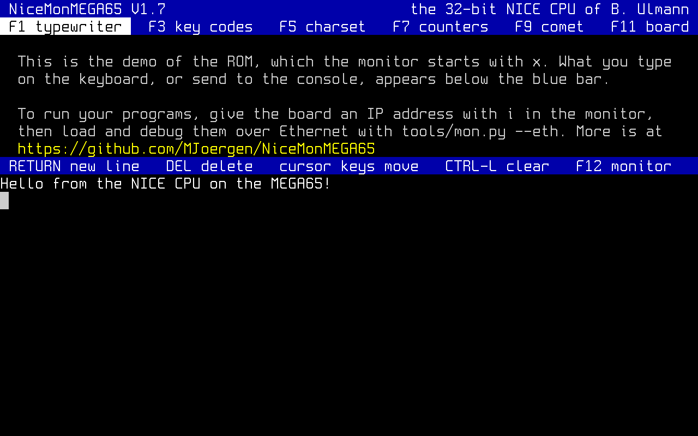
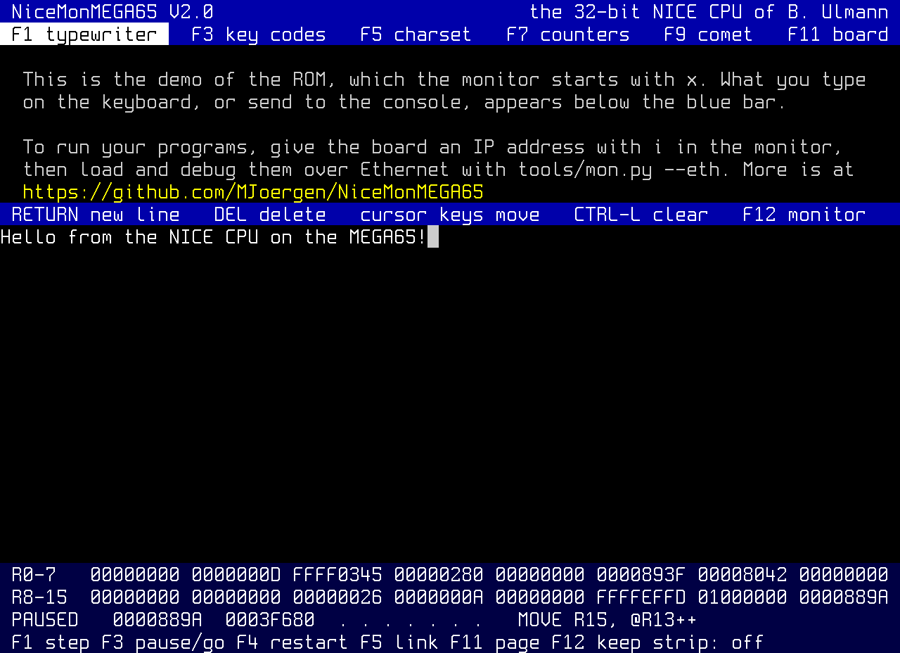
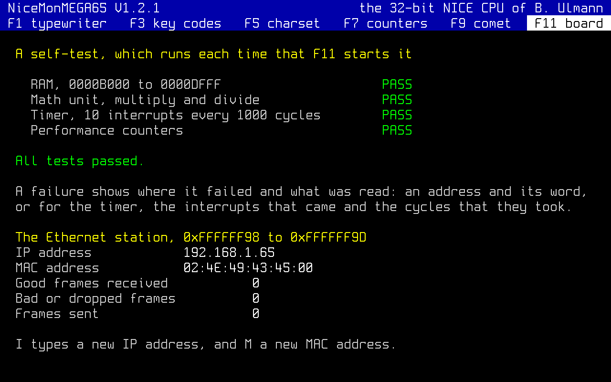

# NiceMonMEGA65

The NICE CPU on the MEGA65, with remote control, and a monitor and a demo in its ROM

The demo in the ROM, which the monitor's `x` runs (see
[demo/](demo/README.md)), drawn from `niceemu` by `tools/screenshot.py`.

This project runs the [NICE CPU](https://github.com/MJoergen/nice_cpu) on
the [MEGA65](https://mega65.org/) (R3 and R6), a modern FPGA computer in
the form of a Commodore 65. NICE is a 32-bit CPU with its own instruction
set, assembler, C toolchain, and emulator, `niceemu`. On the MEGA65, the
system shows a screen of 80×25 characters on HDMI and VGA, and reads the
keyboard. A program written in NICE assembly
([ISA.md](https://github.com/MJoergen/nice_cpu/blob/main/doc/ISA.md))
runs on the board as it runs in `niceemu`. The system also builds for
the Digilent Nexys4DDR (see [synth/](synth/README.md#the-nexys4ddr)).

The Ethernet port, or the debug UART, carries the program's console and
remote control, nice_cpu's debug link, which a PC may use to load, run,
pause, step, and inspect programs.

There are three ways to use the system:

- [On its own](#on-its-own), as a MEGA65 with a keyboard and a screen,
  with no JTAG cable and no serial cable. The program is in the core's
  ROM, the core is loaded from the MEGA65's flash, and MEGA+HELP brings
  up a [debugger](#the-on-board-debugger) on the screen.
- [Over Ethernet](#over-ethernet), with no JTAG cable, where a PC on
  the network may load programs by remote control, talk to them, and
  debug them.
- [Over the serial port](#over-the-serial-port), with a JTAG cable,
  where a PC does the same, with the same tools.

A monitor like QMON, the one in
[QNICE-FPGA](https://github.com/sy2002/QNICE-FPGA), is in the ROM, and
the core boots from it (see [monitor/](monitor/README.md)): a hardware
abstraction layer for programs at `0x8000`, and a few commands, among
them `l`, which loads a program that you type or paste, and `load`,
which loads one from the SD card. Until a BASIC
interpreter takes its place, the ROM also holds the demo, which its
command `x` runs.

## Quick start

1. Download the core file for your board from the latest
   [release](https://github.com/MJoergen/NiceMonMEGA65/releases):
   `nicemon-TAG-r6.cor` for the R6, or `nicemon-TAG-r3.cor` for the R3
   and R3A, where TAG is the release, such as `V1.1`. A core file holds
   its board revision, so use the one for yours.
2. Copy it to the SD card, and hold No Scroll while you switch the MEGA65
   on. MEGAFLASH, the MEGA65's core menu, then writes the core file into
   a slot of the flash.
3. The board then starts the system from that slot. The screen shows a
   welcome, and what you type appears on it (see
   [On its own](#on-its-own)).

No JTAG cable is needed. With one, and pyftdi (`pip install pyftdi`),
`make flash COR=nicemon-V1.0-r6.cor SLOT=1` writes the core file into
slot 1 without the SD card (see [synth/](synth/README.md#building)).

A Nexys4DDR starts the system from its flash in the same way. Write the
release's `nicemon-TAG-nexys4ddr.bit` into the flash once, over the
board's USB cable, with
`make flash PORT=/dev/ttyUSB1 BIT=nicemon-TAG-nexys4ddr.bit`
(needs [openFPGALoader](https://github.com/trabucayre/openFPGALoader)).
Set jumper JP1 (MODE) to QSPI. The board then shows the monitor when it
is switched on, with a USB keyboard in its USB HID port (see
[synth/](synth/README.md#building)).

## Setting up the tools

The tools that compile programs and generate `.cor` files are in this
repository. So are the tools that load and debug programs, which need
[Ethernet](#over-ethernet) or the
[serial port](#over-the-serial-port).
Clone the repository with the submodule, which has the assembler, the
emulator, and the C library:

    git clone --recurse-submodules https://github.com/MJoergen/NiceMonMEGA65.git

or, in an existing clone:

    git submodule update --init

The tools need only Python 3, on Linux or macOS. The emulator, `niceemu`,
is built with `make -C nice_cpu/emulator build`, which needs Zig (see
[nice_cpu/emulator/](https://github.com/MJoergen/nice_cpu/blob/main/emulator/README.md)).

## On its own

With no serial cable, the MEGA65 runs the program in its ROM, from reset.
Programs may read the keyboard and write the screen. The ROM of a
release holds the [monitor](monitor/README.md), which shows its version
and a prompt, `> `, and takes a command on each line: `?` lists them.
`l` loads a program at `0x8000` that you type, or paste into a
plain TCP client on the Ethernet port or a terminal on the serial
port, as the lines of its `.bin` file, and `r` runs it
([monitor/README.md](monitor/README.md#loading-without-a-host)). `load
NAME` loads a `.bin` file that you copied to a FAT32 SD card on a PC,
`save NAME ADDR N` writes one, and `dir` lists the files (see [The SD
cards](#the-sd-cards)). A
program there has 92K words of RAM on the MEGA65, `0x8000` to
`0x1EFFF`, and 28K on the Nexys4DDR.
Until the BASIC interpreter takes its place, the ROM also holds a
[demo](demo/README.md), which `x` and RETURN start. This shows the
version and how to go further, and below that it is a typewriter: what
you type appears on the screen.
RETURN starts a new line, INST/DEL deletes, the cursor keys move the
cursor, and CTRL-L clears what you typed. The function keys switch between
the demos that the second row lists, F12 (SHIFT and F11) goes back to the
monitor, and the reset button starts the monitor again. The ROM can also hold a program of your own (see
[Building your own ROM](#building-your-own-rom)).

### The SD cards

Programs reach the boards' SD cards through the SD card controller of
nice_cpu, at `0xFFFFFFA0`, a sector of 512 bytes at a time, as in
`niceemu --sd0` and `--sd1`. The monitor reads and writes FAT32 cards,
in the folder `NICE` of the root directory, with `dir`, `load`, `save`,
and `del`, and fails on a card without it, as a card may be shared with
other cores, each with a folder of its own. Programs read and write
their files through its entries
([monitor/README.md](monitor/README.md#files)). On the
MEGA65, slot 0 is the microSD slot at the back, and slot 1 the
full-size slot underneath, which holds the MEGA65's system files: a
program that writes there can damage them, so test one on a card of its
own in slot 0. On the Nexys4DDR, slot 0 is its microSD slot.
`make sdcard ETH=192.168.1.65 CMD=ls` lists `NICE` from the host,
`CMD="get NAME"` copies a file off the card, `CMD="put FILE"` writes
one, and `CMD="del NAME"` deletes one, with no PC slot; a write starts
the core again from reset
([tools/README.md](tools/README.md#sdcardpy)).
[SYSTEM.md](doc/SYSTEM.md#the-sd-card-slots) has the details, and the
limits of the R3.

### The on-board debugger

MEGA+HELP brings up the debugger, with no cable and no PC: a strip of
four rows under the program's screen, and the keyboard is the
debugger's until MEGA+HELP is pressed again. The program keeps running
until F3 pauses it. On the Nexys4DDR the key is Scroll Lock.

The demo, paused by F3 after a line was typed, drawn from `niceemu` by
`tools/screenshot.py --debugger`, which lays the strip out as the board
does.

The strip shows R0 to R15, live while the program runs; the state,
`RUNNING`, `WAITING` in a wait for an interrupt, `PAUSED`, `PAUSED W`
paused in a wait, `BRK n` at breakpoint n, `HALTED n` with the reason,
or `HELD`; the PC, the instruction word there, and the flags of
the status register; the instruction decoded, in the assembler's
syntax; and the keys:

| Key | Action |
|---|---|
| F1 | Step: one instruction of a paused program |
| F3 | Pause, or go on |
| F4 (SHIFT and F3) | Restart the program from address 0 |
| F5 | The settings of the link, on or off |
| F11 | The page of memory, on or off |
| F12 | Keep the strip up after MEGA+HELP, or not |
| MEGA+HELP | Back to the program, which gets its keyboard again |

The page replaces the program's screen with a window on the memory.
The cursor keys move through it, CTRL and MEGA with CRSR up or down a
page at a time, and CLR/HOME to the window's first word. Hex digits and RETURN
write a word at the cursor, `a` and an address move the window there,
`b` sets a breakpoint at the cursor or clears it, and ESC leaves. The
program stops at a breakpoint, and the strip says `BRK n`. With `keep
strip: on`, the strip stays on the screen when MEGA+HELP goes back to
the program, live, while the keys are the program's, and a halt or a
breakpoint brings the debugger back.

F5 shows the settings page instead: the IP address, the MAC address,
the TCP port, and the UART's baud rate, as `192.168.1.65`,
`02:4E:49:43:45:00`, `4510`, and `230400`, live. CRSR up and down
choose a setting, and you type the new value as it is shown, or step
through the baud rates with CRSR left and right; RETURN writes it. The
program must be paused, halted, or held. A new address breaks a host's
TCP connection, and a new rate cuts off a host on the serial port until
it follows with `--baud`; a reset brings back 230400.

The debugger cannot load a program. That takes the monitor's `l`, or a
host over [Ethernet](#over-ethernet) or the
[serial port](#over-the-serial-port), which keeps its link while the
debugger is up. The program's 25 rows
sit 64 lines higher than they would centered, whether the strip is
shown or not, so nothing moves when it appears.
[DEBUGGER.md](doc/DEBUGGER.md) has the design.

## Over Ethernet

Remote control runs over the board's Ethernet port, on TCP port 4510. A
PC on the network may then load, run, and debug programs, with no JTAG
cable.

The board answers once it has an IP address, which the monitor, a
program, remote control, or the demo's F11 gives it. After reset, it has
none, and answers nothing. At the monitor's prompt, `i 192.168.1.65` and
RETURN give it that address, and `i` alone shows it. On a network with
a DHCP server, `i dhcp` gets an address from it and shows it, with the
mask, the gateway, and the server, and `tftp 192.168.1.10 hello.bin`
then loads a program from a TFTP server on the network, such as `make
tftpd` on a PC, which serves `examples/build`, and `tftp 192.168.1.10
*.bin` lists its programs
([monitor/README.md](monitor/README.md#the-network)). The board does not renew the lease,
so a server that wants the address back after the lease may give it to
another computer; a fixed address outside the server's range, or one
the server reserves for the MAC address, avoids that. A second board on
the same network also needs a MAC address of its own, which
`m 02:4E:49:43:45:01` gives it, and `m` alone shows it. In the demo's
F11, I types a new IP address, and M a new MAC address:

There are two ways to talk to a program on the board through it:

- `tools/mon.py --eth 192.168.1.65` is an interactive shell. It has the
  features of remote control and the console, in two modes. At its
  prompt, it takes debug commands, shows the program's output, and
  decodes the notices, and `send TEXT` sends text to the program. Its
  `console` command passes your keys straight to the program, as a
  terminal does, until Ctrl-] returns to the prompt.
- A plain client, such as `nc 192.168.1.65 4510`, is a terminal to the
  program. It sends each line you type to the program, and shows what it
  prints. It has none of the features of remote control: it cannot load
  a program, pause it, or read its memory, and the link's notices show
  in it as raw text, such as `h01#C9`.

The other tools take `--eth 192.168.1.65` too (see
[tools/README.md](tools/README.md#over-ethernet)), and
[SYSTEM.md](doc/SYSTEM.md#the-ethernet-station) describes the Ethernet
station. `tools/load.py --eth 192.168.1.65 --monitor prog.bin` runs a
program built for the monitor, at `0x8000`, under the monitor in the
ROM (see
[tools/README.md](tools/README.md#running-a-program-under-the-monitor)). The link has no password, so give the board an IP address only
on a network you trust.

The board serves one connection at a time. While a host is connected,
it has the whole line, the program's console and remote control: what
comes in on the [serial port](#over-the-serial-port) is dropped, and all
output goes to the host. When the host disconnects, the line goes back
to the serial port. The [on-board debugger](#the-on-board-debugger)
(MEGA+HELP) reads the core beside the host, through
the link's side port, so a host keeps its line while the debugger is up,
and sees the `p`, `x`, or `h` of a stop that the debugger caused.

Ctrl-C ends `nc`. Its close is a break, which ends the line's input,
not the keyboard's, until the core is started again or a host connects
again. The board keeps the connection, so the
serial port has no link until a tool connects from the same PC, such as
`tools/mon.py --eth 192.168.1.65`, or the board is reset. The tools end
their connections so that the line goes back at once.

## Over the serial port

Remote control runs over the debug UART too, which needs the JTAG
cable, whose USB port carries it. It runs at 230400 baud, 8-N-1, after
reset, which the tools use by default on Linux and macOS alike, and
the monitor's `baud`, or a write of `0xFFFFFF9F`, sets another rate,
from 115200 to 2 Mbaud ([doc/SYSTEM.md](doc/SYSTEM.md#the-baud-rate)),
which the tools then take with `--baud`. On Linux, 2 Mbaud loads a
program about nine times as fast. A core file older than `V1.9` runs at 2 Mbaud after reset, so
the tools need `--baud 2000000` with it.
`tools/mon.py --port /dev/ttyUSB1` is then the interactive shell, and a
terminal program, such as `picocom`, the plain client, as
[over Ethernet](#over-ethernet). The other tools take `--port` too.

The serial port also gives the board its IP address without the
monitor.
The link writes it to `0xFFFFFFB0`, the first byte in bits 31..24, here
192.168.1.65:

    tools/mon.py --port /dev/ttyUSB1
    dbg> w FFFFFFB0 C0A80141
    dbg> q

## Using the interactive shell

`tools/mon.py` takes the connection to the board as an option, as the
other tools do: `--eth` for the Ethernet port, or `--port` for the
serial port. One of the two must be given:

    tools/mon.py --eth 192.168.1.65
    tools/mon.py --port /dev/ttyUSB1

The shell is the same either way. It starts by printing the state of the
core:

<pre>
$ <b>tools/mon.py --eth 192.168.1.65</b>
halted: HALT, ROM hidden, control 0000000a, link version 0.6, input free 2048
PC=0000000f
</pre>

The core may be running, paused, at a breakpoint, held in reset, halted,
or held after a halt, with the reason. Then come whether the ROM is
hidden, the value of the control register, the version of the link as
major.minor, and the free bytes in the program's input buffer. A paused
or halted core shows its PC too.

The commands are short, and numbers are hex. `help` lists the commands,
and `help CMD` describes one. `load FILE` loads a program, `go` (`g`),
`pause`, and `step N` (`s`) run it, `b ADDR` sets a breakpoint and `bd`
disables it, `regs` and `r ADDR N` show the registers and the memory,
`set Rn VALUE` and `pc ADDR` set a register and the PC of a paused
core, `d ADDR N` disassembles, and `send TEXT` and `console` (`c`) talk to the
program. The program's output and the link's notices, such as
`[paused, PC=...]`, are shown as they arrive. `quit` (`q`) leaves the
core as it is. The shell is nice_cpu's debugger, with the prompt
`dbg>`, and its
[debugger/README.md](https://github.com/MJoergen/nice_cpu/blob/main/debugger/README.md#the-commands)
describes every command; [tools/README.md](tools/README.md#monpy) has
what the board adds.

### A worked example

This session ran on the MEGA65 R6, over its Ethernet port at
192.168.1.65, with `sim/echo.nasm`. These are the instructions of this
short assembly program, and their addresses:

    0  LOOP  MOVE    R1, @CONSOLE      ; bit 8 set when a byte has arrived
    2        AND[M]  R2, R1, 0x100
    4    ?Z  JMP     LOOP              ; nothing yet
    6        AND     R1, R1, 0xFF
    8        MOVE    @CONSOLE, R1      ; echo the byte
    A        SUB[M]  R2, R1, 0x2E      ; a '.'?
    C   ?!Z  JMP     LOOP
    E        HALT

Assemble it, and start `mon.py`. The state shown here is that after an
earlier program halted. Load the program, and the core is held in reset,
with the program in memory. The load clears the memory first, and the
clear ends the earlier halt, so bit 1 of the control register is 0:

<pre>
$ <b>python3 nice_cpu/assembler/niceasm.py -o echo.bin sim/echo.nasm</b>
$ <b>tools/mon.py --eth 192.168.1.65</b>
halted: HALT, ROM hidden, control 0000000a, link version 0.6, input free 2048
PC=0000000f
'help' lists the commands, and 'q' quits.
dbg&gt; <b>load echo.bin</b>
loaded 15 words; the processor is held in reset
dbg&gt; <b>status</b>
held, ROM hidden, control 00000009, link version 0.6, input free 2048
dbg&gt; <b>r 0 f</b>
00000000: 00007800 ffffff00 03a080b0 00000100 3003d800 00000000 01a040b0 000000ff
00000008: 001c0080 ffffff00 022080b0 0000002e b003d800 00000000 0c000000
</pre>

Start the program, and pause it. It waits in its loop for input. The PC
comes with the instruction there, the next one to run. R14 is
`0x09000000`: Z (bit 27), as no byte has arrived, and bit 24, which is
always 1:

<pre>
dbg&gt; <b>go</b>
dbg&gt; <b>pause</b>
[paused, PC=00000000  MOVE R1, @0xffffff00]
dbg&gt; <b>regs</b>
R0  00000000 R1  00000000 R2  00000000 R3  00000000
R4  00000000 R5  00000000 R6  00000000 R7  00000000
R8  00000000 R9  00000000 R10 00000000 R11 00000000
R12 00000000 R13 00000000 R14 09000000 R15 00000000
dbg&gt; <b>s 3</b>
PC=00000002  AND[M] R2, R1, 0x100
PC=00000004  ?Z MOVE R15, 0x0
PC=00000000  MOVE R1, @0xffffff00
</pre>

Set a breakpoint at 6, which the program reaches only when a byte has
arrived, and go on. Send it an `A`, and it stops. R1 holds the console's
read: bit 8 set, and `0x41`, the `A`. R14 is `0x01000000`, as Z is clear:

<pre>
dbg&gt; <b>b 6</b>
0: 00000006
dbg&gt; <b>g</b>
dbg&gt; <b>send A</b>
[breakpoint 0, PC=00000006  AND R1, R1, 0xff]
dbg&gt; <b>regs</b>
R0  00000000 R1  00000141 R2  00000100 R3  00000000
R4  00000000 R5  00000000 R6  00000000 R7  00000000
R8  00000000 R9  00000000 R10 00000000 R11 00000000
R12 00000000 R13 00000000 R14 01000000 R15 00000006
dbg&gt; <b>s</b>
PC=00000008  MOVE @0xffffff00, R1
dbg&gt;
A
PC=0000000a  SUB[M] R2, R1, 0x2e
dbg&gt;
PC=0000000c  ?!Z MOVE R15, 0x0
</pre>

An empty line repeats the last `step` command, here one step at a time.
The step at 8 echoes the `A`. Then disable the breakpoint, go on, and
type to the program in the console, until Ctrl-]. A `.` ends it:

<pre>
dbg&gt; <b>bd all</b>
dbg&gt; <b>g</b>
dbg&gt; <b>c</b>
console; Ctrl-] returns to the prompt
Hello
dbg&gt; <b>send .</b>
.
[halted: HALT, PC=0000000f]
dbg&gt; <b>status</b>
halted: HALT, ROM hidden, control 0000000a, link version 0.6, input free 2048
PC=0000000f
dbg&gt; <b>q</b>
</pre>

## Writing programs

Programs are NICE assembly, or C through WebAssembly.
[PROGRAMMING.md](doc/PROGRAMMING.md) has how to build them, the C
library, and the memory limits. A program uses three levels, which it
describes: the hardware's registers, which every program has, also in
the emulator; the monitor's routines in the ROM, through its dispatch
table at `0x0000`, for a program at `0x8000` that the monitor runs; and
the libraries that a program joins when it is built
([monitor/](monitor/README.md)).

### Building your own ROM

The ROM can hold a program of your own, built into a core file of your
own. There are two steps: first the program, then the core.

The program is
[NICE assembly](https://github.com/MJoergen/nice_cpu/blob/main/doc/ISA.md),
assembled with `niceasm` into a `.bin` file, like any other program:

    python3 nice_cpu/assembler/niceasm.py -o prog.bin prog.nasm

[PROGRAMMING.md](doc/PROGRAMMING.md) has the instructions for writing
programs for this system, the limits and constraints of a program in the
ROM, as well as directions for accessing the screen and the keyboard.
Try the program in `niceemu` first, as there is currently no way to
upload a new ROM to the MEGA65 without building a new `.cor` file.

Then build the core file with the program as its ROM:

    make cor ROM=prog.bin

That builds the cores of the R3 and the R6 with Vivado, with `prog.bin`
embedded within. The core files are located at
`synth/r6/build/NiceMonMEGA65-r6.cor` and
`synth/r3/build/NiceMonMEGA65-r3.cor`, and making them needs `coretool`
(see [synth/](synth/README.md)).

## Documentation

- [doc/](doc/README.md) has the address map, the differences from the
  emulator, and the other reference documents.
- [tools/README.md](tools/README.md) describes the host tools.
- [RELEASE_NOTES.md](doc/RELEASE_NOTES.md) has what changed in each
  release.
- [CONTRIBUTING.md](CONTRIBUTING.md) is for those who change this
  repository: the tests, the formal checks, and the board test.

## License

MIT, see [LICENSE](LICENSE), like the files copied from cmod-s7 and
MandelbrotMEGA65. The exceptions are the third-party files named in
[synth/README.md](synth/README.md):

- `synth/r3/max10.vhd` is GPL v3. It has no license header of its own, so
  this rests on its origin in the MEGA65 core.
- The HDMI output in `synth/mega65/hdmi/` is LGPL v3.
- The Spleen font in `src/video/font_pkg.vhd` is BSD 2-Clause, see
  `font/LICENSE.spleen`.

`src/kbd_m65.vhd` is written after the GPL v3 driver of MiSTer2MEGA65,
with the same timing on the pins but none of its code, and is MIT like the
rest of `src/`.
