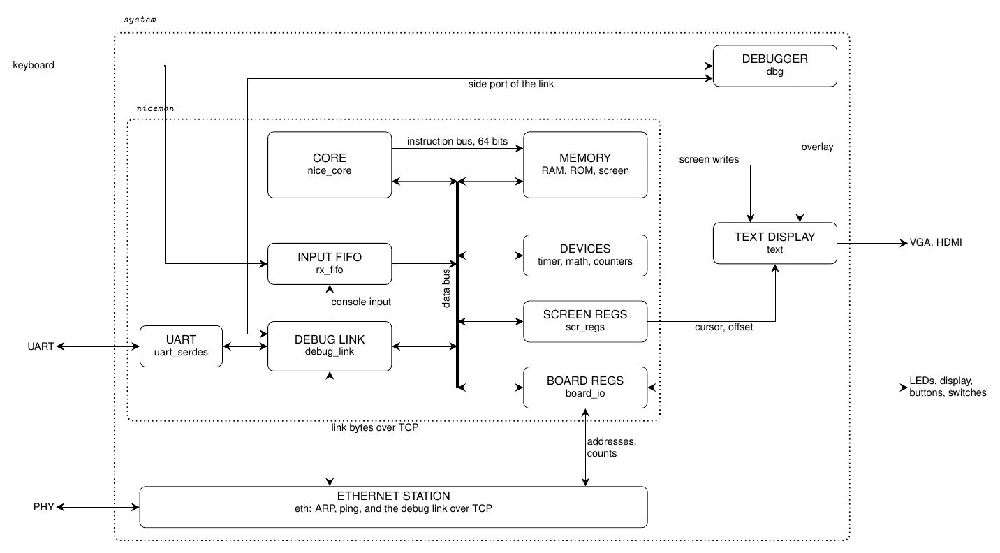

# The system

[system.png](system.png) is drawn by [system.tex](system.tex), and
`make diagrams` in the top directory renders it. Edit the LaTeX, not the
PNG.

Every board instantiates `system` ([system.vhd](system.vhd)). The board
level, in [synth/](../synth/README.md), gives it its clocks, its resets,
and its pins, and drives the keyboard. `system` holds four parts:
`nicemon` ([nicemon.vhd](nicemon.vhd)), which is the computer, the
Ethernet station, the on-board debugger, and the text display. The
header of `nicemon.vhd` is the address map, and
[doc/SYSTEM.md](../doc/SYSTEM.md) describes it for users.

## The parts

- **CORE** runs the program. [nice_core.vhd](nice_core.vhd) wraps the
  nice_cpu core that `NICE=pipeline` or `NICE=multi` picks, with an
  architecture from [core/](core/). It reads instructions on a bus of
  its own, two words at a time, and everything else on the data bus.
- **MEMORY** ([mem.vhd](mem.vhd)) holds the RAM, the ROM that the core
  boots from, and the screen. It has two ports: one for the instruction
  bus and one for the data bus.
- **DEVICES** ([devices.vhd](devices.vhd)) are nice_cpu's: the timer,
  the math unit, the performance counters, and the fetch statistics. The
  timer interrupts the core, which the diagram does not show.
- **SCREEN REGS** ([scr_regs.vhd](scr_regs.vhd)) hold the cursor and the
  display offset.
- **BOARD REGS** ([board_io.vhd](board_io.vhd)) are the Nexys4DDR's
  LEDs, display, buttons, and switches, and, on every board, the
  Ethernet station's addresses and its counts of frames.
- **INPUT FIFO** ([rx_fifo.vhd](rx_fifo.vhd)) holds the console bytes
  that wait for the core: those from the host, which come through the
  link, and those from the keyboard.
- **DEBUG LINK** is nice_cpu's `debug_link`
  ([DEBUG.md](../nice_cpu/doc/DEBUG.md)). A host on the other end reads
  and writes the memory and the registers, loads and starts a program,
  and pauses and steps the core, which also stops at breakpoints. The
  link also carries the console in both directions.
- **UART** ([uart_serdes.vhd](uart_serdes.vhd)) is the link's serial
  line.
- **ETHERNET STATION** ([eth/](eth/README.md)) answers ARP and pings,
  and carries the link over TCP. While a host is connected there, the
  link uses it instead of the UART.
- **DEBUGGER** ([dbg/dbg.vhd](dbg/dbg.vhd),
  [doc/DEBUGGER.md](../doc/DEBUGGER.md)) draws a strip under the
  program's screen, in the text display's overlay. The board's toggle
  key shows it, and then the keyboard's bytes go to the debugger
  instead of the input FIFO, and the debugger reads the core through
  the debug link's side port, by its adapter,
  [dbg/dbg_host.vhd](dbg/dbg_host.vhd), beside the UART and the
  Ethernet station, which keep the line. The strip shows the core's
  state and registers, and the instruction at the PC, decoded by
  [dbg/dbg_decode.vhd](dbg/dbg_decode.vhd), and the function keys run
  the core. A page over the program's screen shows and writes the
  memory and sets breakpoints.
- **TEXT DISPLAY** ([video/text.vhd](video/text.vhd)) keeps its own copy
  of the screen, from the writes to it, and shows it with the cursor and
  the overlay on VGA or HDMI.

## The data bus

The core and the link share the data bus, which is logic in
`nicemon.vhd`, not an entity. While the core runs, the bus is the
core's, and the link reaches only its own registers. While the core is
held, halted, or paused, the bus is the link's.

## The clocks

Most of the system runs on the system clock, 100 MHz on the MEGA65 and
90 MHz on the Nexys4DDR. The text display runs on the pixel clock, and
the Ethernet station's receiver and transmitter on the PHY's 50 MHz
clock. The frames, the screen, and the overlay cross between the clocks
in dual-clock memories, and the few registers through synchronizers.

## On the board level

Some files here are used by the board level, not by `system`: the
keyboards ([kbd_m65.vhd](kbd_m65.vhd) and
[kbd_m65_ascii.vhd](kbd_m65_ascii.vhd) for the MEGA65, and
[kbd_ps2.vhd](kbd_ps2.vhd) and [kbd_ps2_ascii.vhd](kbd_ps2_ascii.vhd)
for the Nexys4DDR, with the debugger's toggle key in
[kbd_m65_toggle.vhd](kbd_m65_toggle.vhd) and
[kbd_ps2_toggle.vhd](kbd_ps2_toggle.vhd)), and the Nexys4DDR's display
and RGB LED drivers ([seg7.vhd](seg7.vhd) and
[rgb_pwm.vhd](rgb_pwm.vhd)).