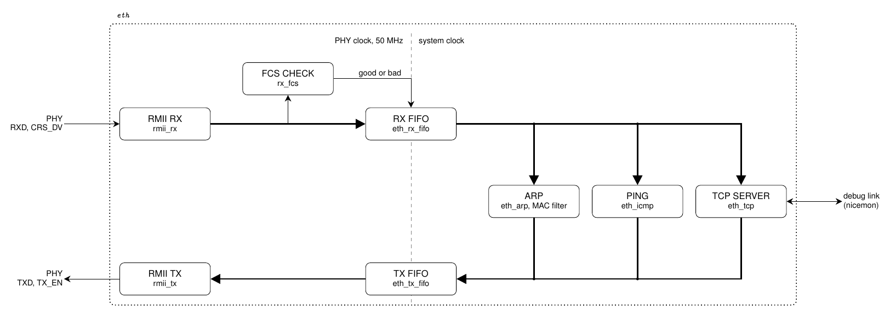

# The Ethernet station

[eth.png](eth.png) is drawn by [eth.tex](eth.tex), and `make diagrams`
in the top directory renders it. Edit the LaTeX, not the PNG.

The station ([eth.vhd](eth.vhd)) connects to the board's Ethernet PHY
by RMII, at 100 Mbit/s. It answers ARP requests and pings for its IP
address, and serves the debug link on TCP port 4510.
[doc/SYSTEM.md](../../doc/SYSTEM.md#the-ethernet-station) describes it
for users.

## The parts

Received frames flow along the top, and frames to send along the bottom.

- **RMII RX** ([rmii_rx.vhd](rmii_rx.vhd)) turns the PHY's pins into the
  bytes of a frame.
- **FCS CHECK** ([rx_fcs.vhd](rx_fcs.vhd)) checks each frame's CRC, and
  says at its end whether it is good or bad.
- **RX FIFO** ([eth_rx_fifo.vhd](eth_rx_fifo.vhd)) keeps the good frames
  and drops the bad ones.
- **ARP** ([eth_arp.vhd](eth_arp.vhd)) answers ARP requests. It also
  holds the MAC filter, which keeps only frames to the station or to
  everyone.
- **PING** ([eth_icmp.vhd](eth_icmp.vhd)) answers ICMP echo requests.
- **TCP SERVER** ([eth_tcp.vhd](eth_tcp.vhd)) serves one connection at a
  time. It passes the host's bytes to the debug link, and the link's
  bytes back. Its parts are the parser of received segments
  ([eth_tcp_rx.vhd](eth_tcp_rx.vhd)), the two buffers
  ([eth_tcp_buf.vhd](eth_tcp_buf.vhd)), the choice of what to send
  ([eth_tcp_pick.vhd](eth_tcp_pick.vhd)), the sender
  ([eth_tcp_tx.vhd](eth_tcp_tx.vhd)), and the retransmission timer
  ([eth_tcp_timer.vhd](eth_tcp_timer.vhd)).
- **TX FIFO** ([eth_tx_fifo.vhd](eth_tx_fifo.vhd)) passes on a frame
  only once it is whole.
- **RMII TX** ([rmii_tx.vhd](rmii_tx.vhd)) adds the preamble, the
  padding, and the CRC, and drives the PHY's pins.

The three readers in the middle see every received frame, and each
keeps only those for it. Their replies share the TX FIFO, one frame at
a time.

## The clocks

The two RMII ends run on the PHY's 50 MHz clock, and the rest on the
system clock. The two FIFOs carry the frames between them, in a
dual-clock memory ([eth_ram.vhd](eth_ram.vhd)) with pointers in Gray
code ([eth_pkg.vhd](eth_pkg.vhd)).
